  

 

  

 

> **`$ ask --me anything`** &nbsp;→&nbsp; Flutter · Firebase · AWS · LLM integration · mobile architecture

 

  

 

  

 

  

 

<kbd>$ git shortlog --stats</kbd> &nbsp;(click to expand)

 

  
  

  

 

  
    
  <code>$ echo "⚡ btw i use arch"</code>

